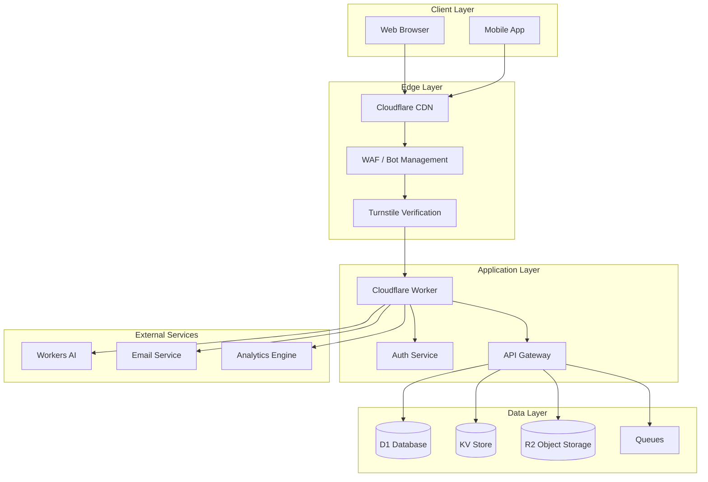
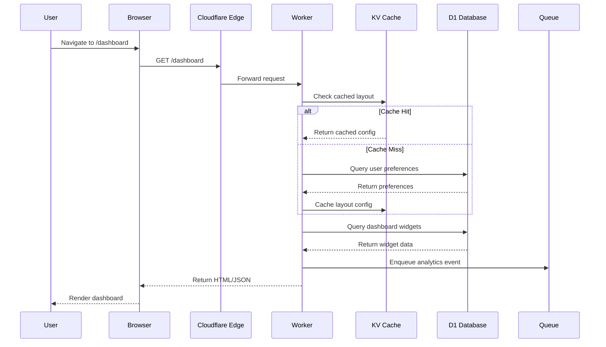
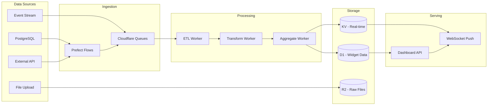
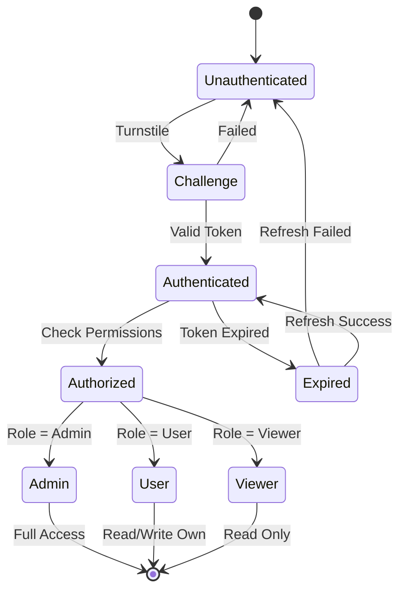
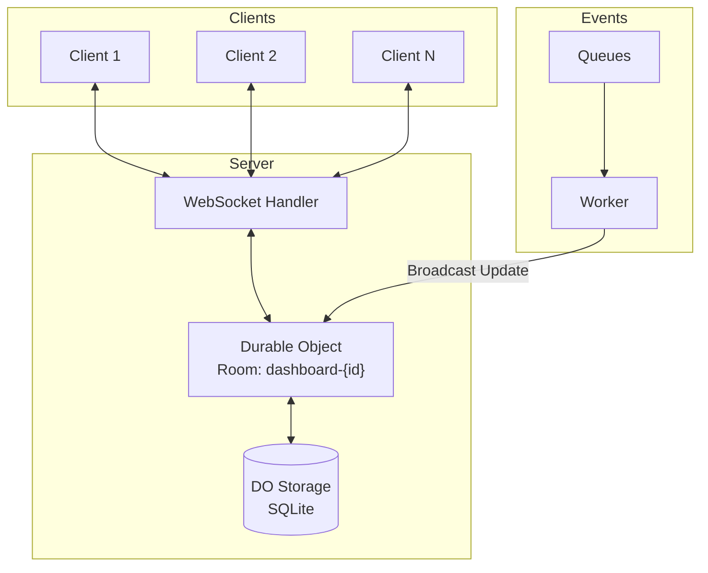
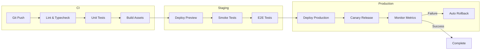
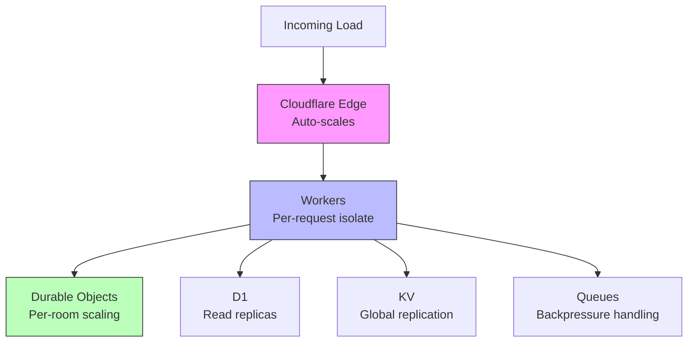
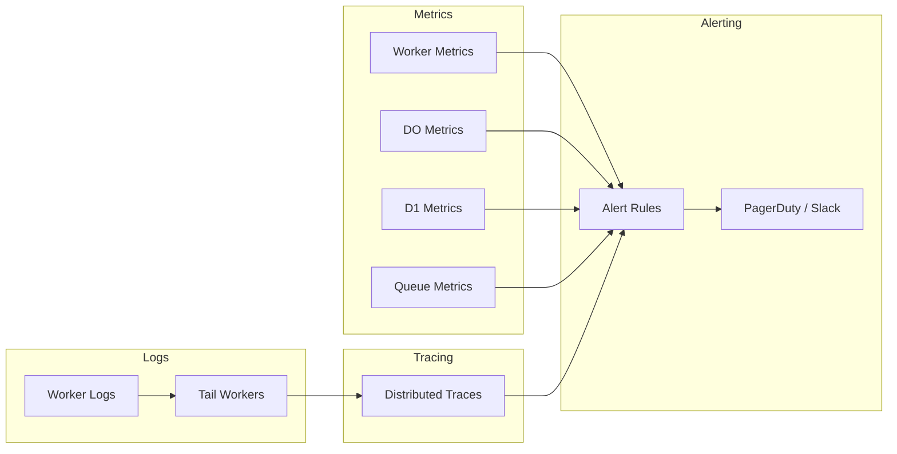
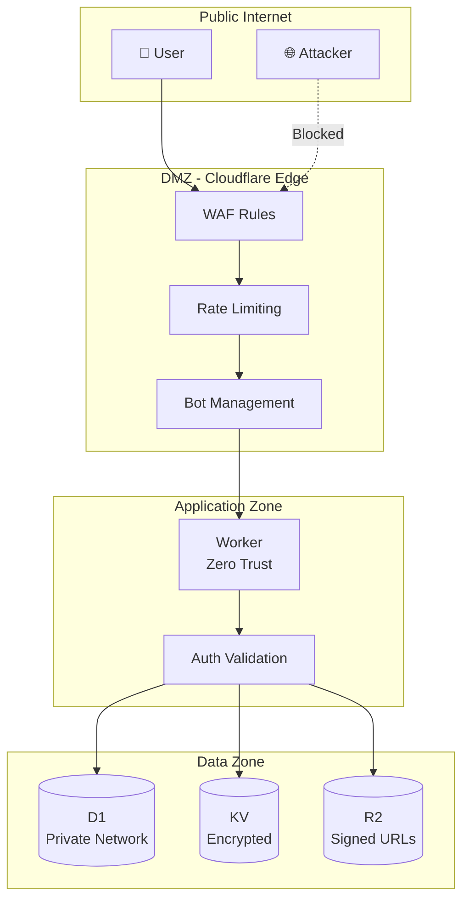
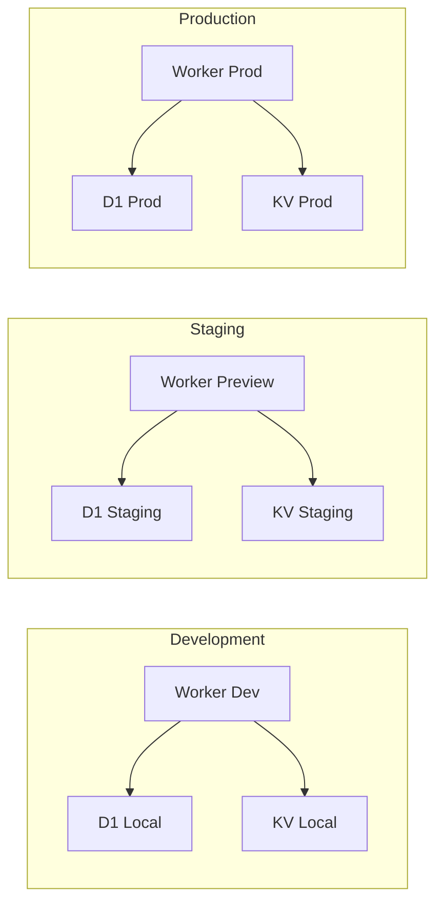

# Dashboard System Design

## Overview

This document describes the system architecture for the Dashboard application, including data flow, component interactions, and deployment topology.

## High-Level Architecture

## Data Flow - Dashboard Load

## Widget Data Pipeline

## Authentication & Authorization

## Real-time Updates

## Deployment Pipeline

## Component Responsibilities

| Component | Responsibility | Technology |
|-----------|---------------|------------|
| Cloudflare Worker | Request routing, auth, API aggregation | TypeScript, Hono |
| Durable Objects | Real-time state, WebSocket coordination | TypeScript, SQLite |
| D1 Database | Persistent relational data | SQLite |
| KV Store | Cached configs, session data | Key-Value |
| R2 Storage | File uploads, exports | S3-compatible |
| Queues | Async processing, analytics | Message Queue |
| Workers AI | ML inference, embeddings | Llama, Embeddings |
| Prefect | Scheduled ETL, data pipelines | Python |

## Scaling Considerations

## Monitoring & Observability

## Security Boundaries

## Environment Configuration

---

*Generated with Mermaid.js - View in any Markdown renderer with Mermaid support (GitHub, GitLab, VS Code, Notion, Obsidian)*