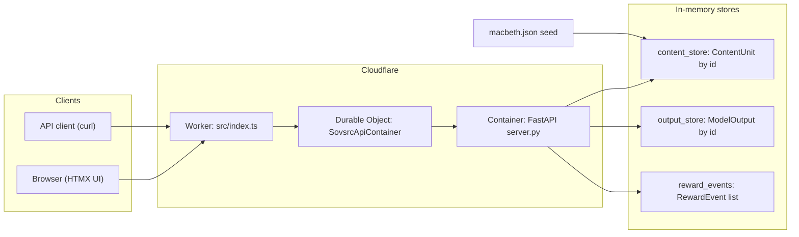
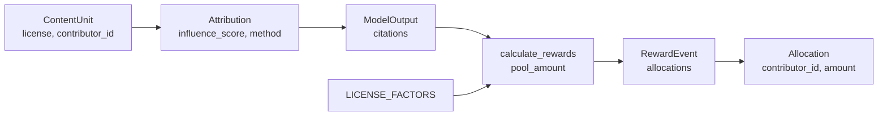
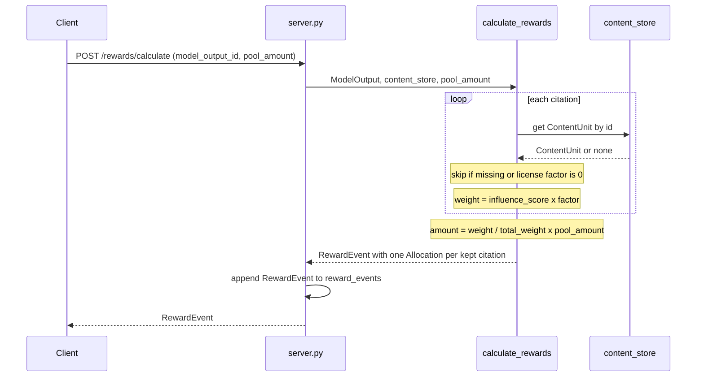

# sovsrc.si.core

Content rewards service for Sovereign Source. The service records licensed
content, attributes model outputs to that content, and pays rewards from a
token pool. A small PyTorch Lightning demo shows the same flow inside a
training loop.

Live: <https://hello.sovsrc.si> (API root) and <https://hello.sovsrc.si/ui>
(HTMX UI). The page at `/ui/readme` renders the ontology from the Pydantic
models at request time.

## System diagram



The Worker sends every request to one container instance, because the
server keeps its state in memory. The container sleeps after 10 minutes
without requests. A cold start takes about one minute.

## Content rewards logic

### Data flow



### Reward calculation



### Rules

The function `calculate_rewards` in `hello_rewards.py` does these steps:

1. Read each `Attribution` in `ModelOutput.citations`.
2. Skip the citation if its `ContentUnit` is not in the store.
3. Skip the citation if the license factor is 0.
4. Compute `weight = influence_score × license_factor`.
5. Add the weight to `total_weight`.
6. Compute `amount = (weight / total_weight) × pool_amount` for each kept citation.
7. Write one `Allocation` per kept citation. The `share` field holds the weight.

All money values use `Decimal`. The allocations sum to the full pool when
at least one citation is kept. When no citation is kept, the event has no
allocations and the pool stays unpaid.

### License factors

| License | Factor | License text |
| --- | --- | --- |
| `sovsrc-rewards-v1` | 1.0 | <https://github.com/niccolox/sovsrc.llm/blob/main/licenses/SS-SIP-0.1.md> |
| `cc-by-4.0` | 0.1 | <https://creativecommons.org/licenses/by/4.0/> |
| `proprietary-opt-in` | 0.5 | <https://github.com/niccolox/sovsrc.llm/blob/main/licenses/PROPRIETARY_OPT_IN.md> |
| `public-domain` | 0.0 | <https://creativecommons.org/publicdomain/zero/1.0/> |

The `source_uri` field of a `ContentUnit` points to the license text, not
to the content source.

### Worked example

Pool = 100. Two citations: `c1` (sovsrc-rewards-v1, factor 1.0, influence
0.6) and `c2` (cc-by-4.0, factor 0.1, influence 0.4).

```text
weight(c1) = 0.6 × 1.0 = 0.60
weight(c2) = 0.4 × 0.1 = 0.04
total      = 0.64
amount(c1) = 0.60 / 0.64 × 100 = 93.75  → alice
amount(c2) = 0.04 / 0.64 × 100 =  6.25  → bob
```

`GET /demo/hello-world` runs this example.

## Ontology

All models are Pydantic v2 and frozen. A record does not change after
creation. The typed models are the single source of truth. The API
payloads and the README page derive from them.

| Model | Fields | Points to |
| --- | --- | --- |
| `ContentUnit` | `id`, `text`, `source_uri`, `license`, `contributor_id`, `metadata`, `created_at` | license text by `source_uri` |
| `TrainingContentUnit` | `ContentUnit` fields plus `tensor_x`, `tensor_y` | one training sample |
| `Attribution` | `content_unit_id`, `influence_score` (0.0 to 1.0), `method` | `ContentUnit.id` |
| `ModelOutput` | `id`, `prompt`, `response`, `citations`, `model_version`, `timestamp` | list of `Attribution` |
| `Allocation` | `content_unit_id`, `contributor_id`, `share`, `amount` | `ContentUnit` |
| `RewardEvent` | `id`, `model_output_id`, `pool_amount`, `allocations`, `calculated_at` | `ModelOutput.id` |

Enums:

| Enum | Values |
| --- | --- |
| `LicenseType` | `sovsrc-rewards-v1`, `cc-by-4.0`, `proprietary-opt-in`, `public-domain` |
| `AttributionMethod` | `exact_match`, `semantic_similarity`, `inference_trace` |

## Training flow

`GET /demo/unified` and `unified_hello.py` train a small Lightning model on
100 synthetic samples. Each sample is a `TrainingContentUnit` with a
license and a contributor.

1. In each training step, write one `Attribution` per sample in the batch
   with `influence_score = 1 / batch_size`.
2. At the end of the epoch, sum the influence scores per content unit.
3. Build one `ModelOutput` for the epoch with those sums as citations.
4. Call `calculate_rewards` with a pool of 1000.
5. Store the `RewardEvent` and report earnings per contributor.

## API

| Method | Path | Purpose |
| --- | --- | --- |
| GET | `/` | Service name, version, and endpoint list |
| POST | `/content` | Add a `ContentUnit` (`text`, `source_uri`, `license`, `contributor_id`, `metadata`) |
| GET | `/content` | List content units. Filter with `license` or `filter` (id prefix) |
| GET | `/content/{content_id}` | Get one content unit |
| POST | `/attribute` | Record a `ModelOutput` (`prompt`, `response`, `citations`) |
| POST | `/rewards/calculate` | Pay a pool for one output (`model_output_id`, `pool_amount`) |
| GET | `/rewards/ledger` | List all reward events |
| GET | `/contributors/{contributor_id}/earnings` | Sum the earnings of one contributor |
| GET | `/leaderboard/macbeth` | Rank the Macbeth contributors |
| GET | `/leaderboard/macbeth/values` | Rank by license value |
| GET | `/leaderboard/macbeth/characters` | Rank by character |
| GET | `/demo/hello-world` | Run the worked example |
| GET | `/demo/unified` | Run the training demo |
| GET | `/ui`, `/ui/content`, `/ui/attribute`, `/ui/rewards`, `/ui/demo`, `/ui/leaderboard`, `/ui/readme` | HTMX pages |

The server seeds three content units and 16 Macbeth speeches from
`macbeth.json` at start.

## MCP server

The service is also an MCP server. The tools work on the same stores and
the same Pydantic models as the REST API, so every tool returns a
schema-valid object. The code is in `rewards_mcp.py`.

| Transport | Endpoint |
| --- | --- |
| Streamable HTTP | `https://hello.sovsrc.si/mcp` (stateless, JSON responses) |
| stdio | `python mcp_stdio.py` |

Add it to Claude Code:

```bash
claude mcp add --transport http sovsrc-rewards https://hello.sovsrc.si/mcp
# or local stdio
claude mcp add sovsrc-rewards -- python /path/to/sovsrc.si.core/mcp_stdio.py
```

| Tool | Purpose |
| --- | --- |
| `list_licenses` | License types with factor and license text URL |
| `list_content` | List content units. Filter by `license` or `id_prefix` |
| `get_content` | Get one content unit by id |
| `add_content` | Add a content unit |
| `record_model_output` | Record a model output with citations |
| `calculate_reward_event` | Pay a pool for one recorded output |
| `get_ledger` | List all reward events |
| `get_contributor_earnings` | Sum the earnings of one contributor |
| `leaderboard` | Rank contributors over content units with an id prefix |

Resource `sovsrc://ontology` returns the JSON schema of the models.

### Access gateway for the MCP endpoint

Cloudflare Access protects `/mcp`. Two layers enforce it:

1. A self-hosted Access application for `hello.sovsrc.si/mcp` with Managed
   OAuth on. An MCP client gets a `401` with a `WWW-Authenticate` header,
   opens the browser for the Access login, and then sends an OAuth token.
   Access checks the policy and forwards the user JWT to the Worker in the
   `Cf-Access-Jwt-Assertion` header.
2. The Worker in `src/index.ts` verifies that JWT against the team domain
   JWKS and the application AUD before it forwards `/mcp` requests to the
   container. This also covers the `workers.dev` hostname, which Access
   does not front. The container receives the verified email in the
   `X-Access-User` header. Other paths stay public.

Create the Access application with the script. The API token needs the
permission `Access: Apps and Policies Write`.

```bash
export CLOUDFLARE_API_TOKEN=...
python scripts/access_gateway.py --email you@example.com
make deploy
```

The script writes `TEAM_DOMAIN` and `POLICY_AUD` into `wrangler.toml`.
While those two values are empty, the Worker answers `/mcp` with `403`.

## Run locally

```bash
make install        # install Python dependencies
make test           # run hello_rewards.py
make run-unified    # run the training demo
make run-server     # start the API on http://localhost:8000
make run-mcp        # start the MCP server over stdio
./run_curl_examples.sh
```

Or build the container image:

```bash
make docker-build
docker run --rm -p 8000:8000 sovsrc-si-core:local
```

## Deploy to Cloudflare

The service runs on Cloudflare Workers with Containers. `wrangler.toml`
declares the container class, the `basic` instance type, the custom domain
`hello.sovsrc.si`, and the Durable Object migration.

```bash
make deploy         # npm install, then wrangler deploy
```

Notes:

- The Dockerfile installs the CPU-only torch wheel. The default wheel
  pulls in about 4 GB of CUDA libraries.
- The Cloudflare registry drops uploads of layers above about 100 MB
  compressed. The Dockerfile ships the Python packages in several layers
  and splits `libtorch_cpu.so` into four chunks. `entrypoint.sh` joins
  them on first start.
- If a push fails with `use of closed network connection`, run the deploy
  again. Pushed layers stay in the registry.

## Files

| File | Purpose |
| --- | --- |
| `hello_rewards.py` | Pydantic models, license factors, `calculate_rewards`, worked example |
| `unified_hello.py` | Lightning training loop with per-epoch rewards |
| `server.py` | FastAPI app, in-memory stores, HTMX routes, README page, MCP mount |
| `rewards_mcp.py` | MCP tools and resource on the same stores and models |
| `mcp_stdio.py` | Run the MCP server over stdio |
| `templates/` | Jinja2 templates for the HTMX UI |
| `macbeth.json` | Seed content: Macbeth speeches with per-speech licenses |
| `src/index.ts` | Cloudflare Worker that verifies the Access JWT on `/mcp` and routes to the container |
| `scripts/access_gateway.py` | Create the Access application for `/mcp` and write its values to `wrangler.toml` |
| `Dockerfile`, `entrypoint.sh` | Container image for Cloudflare |
| `wrangler.toml` | Worker and container configuration |
